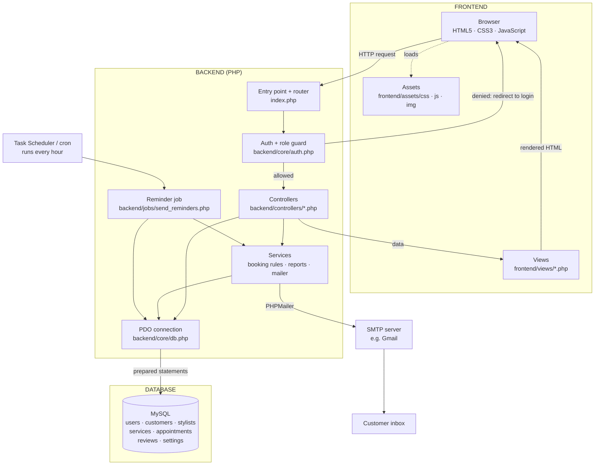
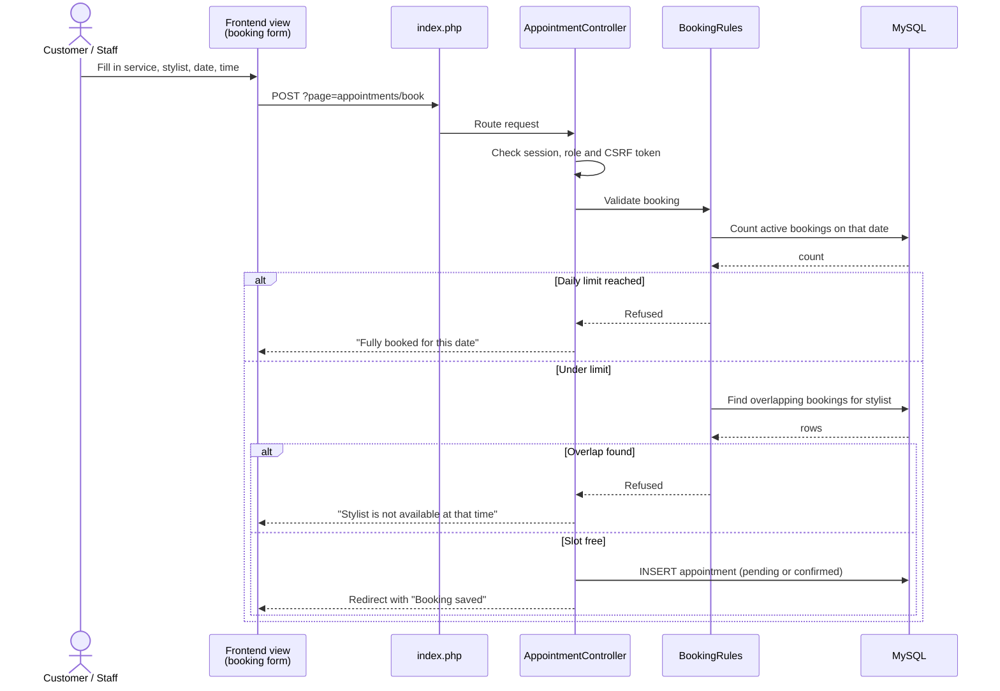
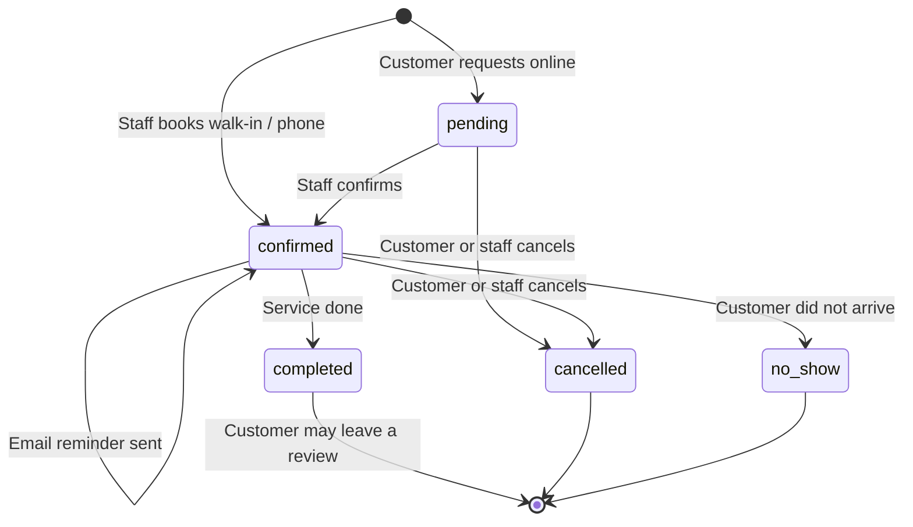
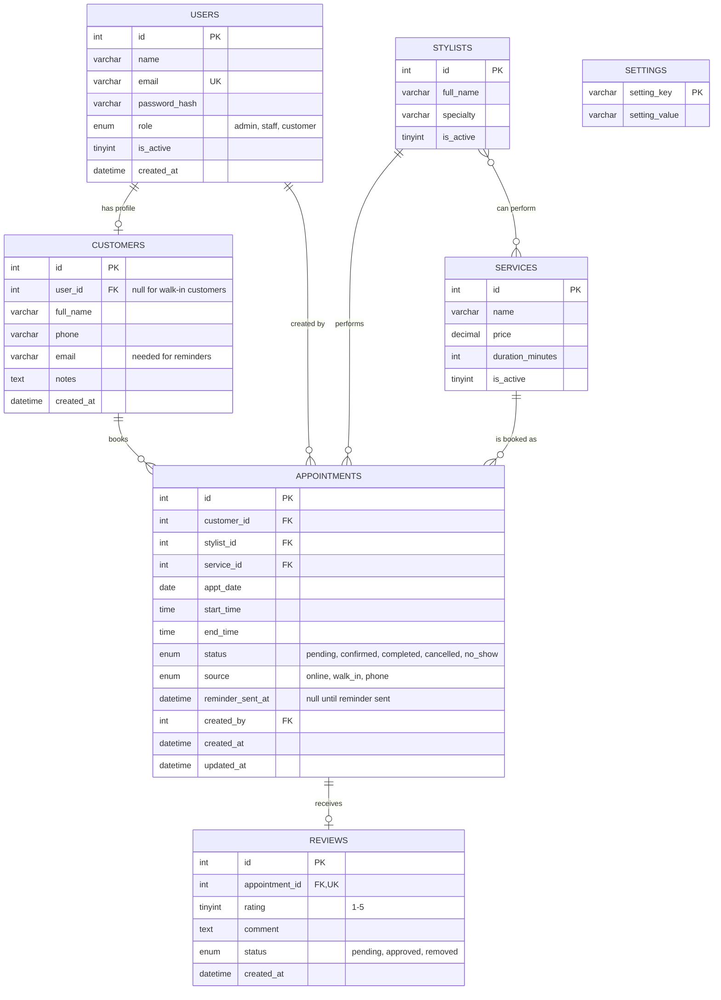

# AMOURÉ SALON: Salon Appointment Scheduling and Customer Management System

A web-based management system that lets AMOURÉ SALON record and monitor all appointments and customer records in one place, replacing notebooks and scattered chat messages, and reminds customers of their appointments by email.

**Course:** Web Management System, BSCS-3C **Author:** Fedoc, Cyrene Nathalie B. **Submitted to:** Prof. Wendy Anas

---

## Table of contents

1. [Project status](#1-project-status)
2. [Problem and solution](#2-problem-and-solution)
3. [Features](#3-features)
4. [User roles](#4-user-roles)
5. [Architecture](#5-architecture)
6. [Tech stack](#6-tech-stack)
7. [Repository layout](#7-repository-layout)
8. [Database design](#8-database-design)
9. [Prerequisites](#9-prerequisites)
10. [Installation](#10-installation)
11. [Configuration](#11-configuration)
12. [Running the system](#12-running-the-system)
13. [Modules reference](#13-modules-reference)
14. [Business rules](#14-business-rules)
15. [Authentication and access control](#15-authentication-and-access-control)
16. [Security safeguards](#16-security-safeguards)
17. [Testing and verification](#17-testing-and-verification)
18. [Known limitations](#18-known-limitations)
19. [Troubleshooting](#19-troubleshooting)
20. [Design decisions](#20-design-decisions)
21. [Future work](#21-future-work)

---

## 1. Project status

**In development (rebuilt from scratch).** The repository was restarted to follow the approved project proposal. Progress per module:

| Module | Status |
| --- | --- |
| Login and Logout | Planned |
| Dashboard | Planned |
| Customer Management | Planned |
| Services and Stylists Management | Planned |
| Appointment Scheduling | Planned |
| Appointment Status Monitoring | Planned |
| Email Reminders | Planned |
| Customer Reviews | Planned |
| Search and Filtering | Planned |
| Reports | Planned |

Update each row to *In progress* or *Done* as work is completed.

---

## 2. Problem and solution

### Problem

Many small salons accept bookings through walk-ins, phone calls, text messages and social media chats, and write appointments and customer details in notebooks. Because bookings come from different channels and are recorded by hand:

- two customers can be booked with the same stylist at the same time;
- cancelled or moved bookings are not always updated;
- customers forget their appointments, leaving empty time slots;
- customer details and past services are scattered and hard to find;
- completed, cancelled and missed appointments must be counted by hand.

Owners, receptionists, stylists and customers are all affected: customers wait longer, staff spend time checking records instead of serving customers, and owners have little information to review business activity.

### Solution

A web-based system that keeps every appointment and customer record in one database:

- customers request appointments online; the receptionist records walk-in and phone bookings;
- before saving, the system checks that the stylist is free for that time slot and that the salon's **daily appointment limit** has not been reached;
- each appointment carries a status: `pending`, `confirmed`, `completed`, `cancelled` or `no_show`;
- customers with confirmed appointments receive an **email reminder** before their appointment, to reduce no-shows;
- after a completed service, the customer can leave a rating and review, shown as a customer vouch once the administrator approves it;
- a dashboard and reports summarize daily and monthly activity.

---

## 3. Features

| Feature / Module | Purpose |
| --- | --- |
| Login and Logout | Signs in administrators, staff and customers, and shows each user only the functions allowed for their role. |
| Dashboard | Shows today's appointments and the number of pending, confirmed, completed and cancelled bookings. |
| Customer Management | Stores customer names and contact details and shows each customer's appointment history. |
| Services and Stylists Management | Maintains services with price and duration, and the stylists who perform them. |
| Appointment Scheduling | Customers request bookings; staff create, edit, reschedule and cancel them, with overlap and daily-limit checks. |
| Appointment Status Monitoring | Tracks each booking's status so cancelled bookings free up their time slot. |
| Email Reminders | Automatically emails customers a reminder before their confirmed appointment (default: 24 hours before). |
| Customer Reviews | Customers rate and review completed services; approved reviews are shown as vouches. |
| Search and Filtering | Finds customers and appointments by name, date, stylist, service or status. |
| Reports | Appointments per day or month, completed / cancelled / no-show counts, popular services, average ratings and reminders sent. |

---

## 4. User roles

| Role | Can do |
| --- | --- |
| **Administrator / Owner** | Manage user accounts, services, prices, stylists, the daily appointment limit and reminder settings; view all appointments and customer records; send pending reminders manually; approve or remove reviews; generate reports. |
| **Receptionist / Staff** | Register and update customers; create, reschedule and cancel appointments; confirm online booking requests; update appointment statuses; view the daily schedule. |
| **Customer** | Create an account; view services and stylists; request an appointment; receive email reminders; view own appointments and history; cancel or request to reschedule; rate and review a completed service. Customers see **only their own records**. |

---

## 5. Architecture

The system is split into a **frontend** (what the user sees), a **backend** (logic and rules) and a **database**. Every browser request goes through one entry point, `index.php`, which routes it to a backend controller. The controller checks the user's role, applies the business rules, reads or writes MySQL, then passes the data to a frontend view that is returned as HTML.

A separate **reminder job** runs on a schedule, finds upcoming confirmed appointments and emails the customers.



### Frontend and backend responsibilities

| Layer | Folder | Responsibility |
| --- | --- | --- |
| Frontend | `frontend/views/` | Page templates: layout, forms, tables, dashboards, email template. Display only; no SQL. |
| Frontend | `frontend/assets/` | Stylesheets, client-side scripts (form hints, filters, confirm dialogs) and images such as the logo. |
| Backend | `index.php` | Single entry point; reads `?page=` and calls the matching controller. |
| Backend | `backend/core/` | Database connection, sessions and role guard, CSRF tokens, helpers. |
| Backend | `backend/controllers/` | One controller per module; handles GET/POST, validates input, loads data, chooses a view. |
| Backend | `backend/services/` | Shared rules: overlap and daily-limit checks, report queries, sending email. |
| Backend | `backend/jobs/` | Scripts run by the scheduler, not by the browser (email reminders). |
| Database | `database/` | Schema and sample data. |

### Request flow: booking an appointment



### Reminder flow: email before the appointment

```mermaid
sequenceDiagram
    participant S as Task Scheduler / cron
    participant J as send_reminders.php
    participant D as MySQL
    participant M as Mailer (PHPMailer)
    participant E as SMTP server
    actor C as Customer

    S->>J: Run every hour
    J->>D: Select confirmed appointments starting within the next N hours,<br/>reminder not yet sent, customer has an email
    D-->>J: appointments
    loop Each appointment
        J->>M: Build email from frontend/views/emails/reminder.php
        M->>E: Send
        alt Sent
            E-->>C: Reminder email
            J->>D: SET reminder_sent_at = NOW()
        else Failed
            J->>J: Log error; leave reminder_sent_at empty to retry next run
        end
    end
```

### Appointment status lifecycle



---

## 6. Tech stack

| Layer | Technology |
| --- | --- |
| Frontend | HTML5, CSS3, vanilla JavaScript |
| Backend | PHP 8.x (no framework), simple controller + view structure |
| Database | MySQL 8 / MariaDB 10.4+ |
| Database access | PDO with prepared statements |
| Email | PHPMailer over SMTP (e.g. Gmail with an App Password) |
| Dependency manager | Composer (installs PHPMailer) |
| Scheduling | Windows Task Scheduler (XAMPP) or cron (Linux) |
| Local server | XAMPP (Apache + MySQL + phpMyAdmin) |
| Version control | Git and GitHub |

### Skills applied

PHP backend development · MySQL database design · HTML5, CSS3 and JavaScript · frontend/backend separation · role-based access control · email integration (PHPMailer) · scheduled tasks · web security (SQL injection, XSS, CSRF) · Git and GitHub

Full list, with where each skill is used and how the project meets the course objectives: **[PROJECT_SKILLS.md](PROJECT_SKILLS.md)**

---

## 7. Repository layout

```text
amoure-salon/
├── index.php                      # entry point + router (?page=...)
├── .htaccess
├── composer.json                  # requires phpmailer/phpmailer
├── vendor/                        # created by Composer, ignored by git
│
├── frontend/                      # ── FRONTEND ──
│   ├── assets/
│   │   ├── css/style.css
│   │   ├── js/app.js
│   │   └── img/logo.png
│   └── views/
│       ├── layouts/
│       │   ├── header.php
│       │   ├── footer.php
│       │   └── sidebar.php
│       ├── public/                # home (services + approved reviews), login, register
│       ├── admin/                 # dashboard, users, services, stylists, settings, reviews, reports
│       ├── staff/                 # dashboard, customers, appointments, schedule
│       ├── customer/              # book, my-appointments, review
│       └── emails/
│           └── reminder.php       # reminder email template
│
├── backend/                       # ── BACKEND ──  (.htaccess: deny direct access)
│   ├── config/
│   │   ├── database.example.php
│   │   ├── mail.example.php
│   │   ├── database.php           # ignored by git
│   │   └── mail.php               # ignored by git
│   ├── core/
│   │   ├── db.php                 # PDO connection
│   │   ├── auth.php               # session, login check, require_role()
│   │   ├── csrf.php
│   │   └── helpers.php            # escaping, redirects, flash messages
│   ├── controllers/
│   │   ├── AuthController.php
│   │   ├── DashboardController.php
│   │   ├── CustomerController.php
│   │   ├── ServiceController.php
│   │   ├── StylistController.php
│   │   ├── AppointmentController.php
│   │   ├── ReviewController.php
│   │   ├── ReportController.php
│   │   └── SettingsController.php
│   ├── services/
│   │   ├── BookingRules.php       # overlap + daily-limit checks
│   │   ├── ReminderService.php    # finds due appointments, sends reminders
│   │   ├── Mailer.php             # PHPMailer wrapper
│   │   └── ReportService.php
│   ├── jobs/
│   │   └── send_reminders.php     # run by Task Scheduler / cron
│   └── logs/                      # mail errors, ignored by git
│
├── database/                      # ── DATABASE ──  (.htaccess: deny direct access)
│   ├── schema.sql
│   └── seed.sql
│
├── .gitignore
├── PROJECT_SKILLS.md
└── README.md
```

`.gitignore` should contain at least:

```text
/vendor/
/backend/config/database.php
/backend/config/mail.php
/backend/logs/*
```

---

## 8. Database design

### Entity relationships



A `stylist_services` junction table links stylists to the services they can perform.

### Key constraints and indexes

- `users.email` is unique.
- `reviews.appointment_id` is unique: one review per appointment.
- `appointments (stylist_id, appt_date, start_time)` is indexed for the overlap check.
- `appointments (appt_date, status)` is indexed for the daily limit, dashboard, reports and reminder job.
- `settings` holds `daily_appointment_limit`, `reminders_enabled` and `reminder_hours_before`.

---

## 9. Prerequisites

- XAMPP 8.x (PHP 8.0 or later, Apache, MySQL/MariaDB) with the `openssl` extension enabled
- Composer
- An email account for sending (e.g. Gmail with 2-Step Verification and an App Password)
- A modern browser (Chrome, Edge or Firefox)
- Git

---

## 10. Installation

1. Clone the repository into the XAMPP web folder:

   ```bash
   cd C:/xampp/htdocs
   git clone https://github.com/<your-username>/amoure-salon.git
   cd amoure-salon
   ```

2. Install PHPMailer:

   ```bash
   composer install
   ```

3. Start **Apache** and **MySQL** in the XAMPP Control Panel.
4. Open `http://localhost/phpmyadmin`, create a database named `amoure_salon_db` (collation `utf8mb4_general_ci`).
5. Import `database/schema.sql`, then `database/seed.sql`.
6. Copy `backend/config/database.example.php` to `backend/config/database.php`, and `backend/config/mail.example.php` to `backend/config/mail.php`, then fill them in (see [Configuration](#11-configuration)).
7. Set up the reminder job (see [Running the system](#12-running-the-system)).

---

## 11. Configuration

### Database: `backend/config/database.php`

```php
<?php
return [
    'host' => 'localhost',
    'name' => 'amoure_salon_db',
    'user' => 'root',
    'pass' => '',          // XAMPP default is empty
];
```

`backend/core/db.php` uses these values to open the PDO connection with `charset=utf8mb4`, `ERRMODE_EXCEPTION` and emulated prepares turned off.

### Email: `backend/config/mail.php`

```php
<?php
return [
    'host'       => 'smtp.gmail.com',
    'port'       => 587,
    'encryption' => 'tls',
    'username'   => 'your-salon-email@gmail.com',
    'password'   => 'your-16-character-app-password',
    'from_email' => 'your-salon-email@gmail.com',
    'from_name'  => 'AMOURÉ SALON',
];
```

Use a Gmail **App Password**, not your normal Gmail password.

### Settings changed in the system

In **Admin › Settings** the administrator can change:

| Setting | Default | Meaning |
| --- | --- | --- |
| `daily_appointment_limit` | `[SET BY ADMIN]` | Maximum appointments accepted per day |
| `reminders_enabled` | `1` | Turn email reminders on or off |
| `reminder_hours_before` | `24` | How many hours before the appointment the reminder is sent |

---

## 12. Running the system

Open `http://localhost/amoure-salon/` in the browser.

Seed accounts (change the passwords after the first login):

| Role | Email | Password |
| --- | --- | --- |
| Administrator | `admin@amoure.test` | `[SET IN seed.sql]` |
| Staff | `staff@amoure.test` | `[SET IN seed.sql]` |
| Customer | `customer@amoure.test` | `[SET IN seed.sql]` |

### Running the email reminder job

Run it once by hand to test:

```bash
C:\xampp\php\php.exe C:\xampp\htdocs\amoure-salon\backend\jobs\send_reminders.php
```

Schedule it to run every hour:

- **Windows (XAMPP):** Task Scheduler › Create Basic Task › Daily › repeat every 1 hour; Action: *Start a program*, Program: `C:\xampp\php\php.exe`, Arguments: `C:\xampp\htdocs\amoure-salon\backend\jobs\send_reminders.php`.
- **Linux (cron):**

  ```text
  0 * * * * php /var/www/amoure-salon/backend/jobs/send_reminders.php
  ```

For a class demo, the administrator can also click **Send due reminders now** in **Admin › Settings**, which runs the same logic.

---

## 13. Modules reference

Pages are opened through `index.php?page=<route>`.

| Module | Route(s) | Controller | Roles |
| --- | --- | --- | --- |
| Login and Logout | `login`, `register`, `logout` | `AuthController` | All |
| Dashboard | `admin/dashboard`, `staff/dashboard` | `DashboardController` | Admin, Staff |
| Customer Management | `staff/customers` | `CustomerController` | Admin, Staff |
| Services and Stylists | `admin/services`, `admin/stylists` | `ServiceController`, `StylistController` | Admin |
| Appointment Scheduling | `customer/book`, `staff/appointments` | `AppointmentController` | All |
| Status Monitoring | `staff/appointments`, `staff/schedule` | `AppointmentController` | Admin, Staff |
| Email Reminders | `admin/settings` (manual send); `backend/jobs/send_reminders.php` | `SettingsController`, `ReminderService` | Admin, scheduler |
| Customer Reviews | `customer/review`, `admin/reviews` | `ReviewController` | Customer, Admin |
| Search and Filtering | filter bar on customer and appointment lists | `CustomerController`, `AppointmentController` | Admin, Staff |
| Reports | `admin/reports` | `ReportController` | Admin |
| Settings | `admin/settings` | `SettingsController` | Admin |

---

## 14. Business rules

1. **No overlapping bookings.** A booking is refused if the same stylist already has a `pending` or `confirmed` appointment on that date where
   `new_start < existing_end AND new_end > existing_start`.
   `end_time` is computed from the service's `duration_minutes`.
2. **Daily appointment limit.** A booking is refused when the number of `pending`, `confirmed` and `completed` appointments on that date has reached `daily_appointment_limit`.
3. **Cancelled and no-show bookings free their slot.** They are ignored by both checks above.
4. **Online requests start as `pending`.** Staff must confirm them. Walk-in and phone bookings entered by staff start as `confirmed`.
5. **Status changes follow the lifecycle** in [Architecture](#5-architecture); `completed`, `cancelled` and `no_show` are final.
6. **Email reminders** are sent only when all of these are true:
   - `reminders_enabled` is on;
   - the appointment is `confirmed`;
   - it starts within the next `reminder_hours_before` hours and has not started yet;
   - `reminder_sent_at` is empty;
   - the customer has an email address.
   Each appointment gets **at most one** reminder. A failed send leaves `reminder_sent_at` empty so the next run retries it.
7. **Rescheduling clears the reminder.** When an appointment's date or time changes, `reminder_sent_at` is reset so the customer is reminded of the new time.
8. **Reviews** are allowed only for the customer's own `completed` appointment, once per appointment, with a rating from 1 to 5. New reviews are `pending` and appear publicly only after an administrator approves them.
9. **Bookings in the past** are refused.
10. **Inactive services or stylists** cannot be booked.

---

## 15. Authentication and access control

- Passwords are stored with `password_hash()` and checked with `password_verify()`.
- After login, the session stores the user ID and role; `session_regenerate_id(true)` runs on login.
- Every controller action calls a guard such as `require_role(['admin'])` before any other code.
- Customers can read and change only rows linked to their own `customer_id`; every query for customer pages filters by the logged-in user.
- Deactivated accounts (`is_active = 0`) cannot log in.
- Logout destroys the session and its cookie.
- `backend/`, `database/` and `vendor/` cannot be opened from the browser (`.htaccess` with `Require all denied`); the reminder job can only be run from the command line.

---

## 16. Security safeguards

| Risk | Safeguard |
| --- | --- |
| SQL injection | PDO prepared statements for every query |
| Cross-site scripting (XSS) | All output escaped with `htmlspecialchars()`, including email templates |
| Cross-site request forgery (CSRF) | Token on every POST form, checked server-side |
| Password exposure | `password_hash()` (bcrypt); no plain-text storage |
| Session fixation | Session ID regenerated on login |
| Unauthorized access | Role guard on every controller; ownership checks on customer data |
| Direct access to backend files | `.htaccess` denies `backend/`, `database/`, `vendor/`; job script exits if not run from CLI (`php_sapi_name() !== 'cli'`) |
| Invalid input | Server-side validation of dates, times, IDs, emails, ratings and required fields (JavaScript checks are a convenience only) |
| Leaked credentials | `database.php` and `mail.php` listed in `.gitignore`; SMTP uses an App Password |
| Email header injection | Customer names and emails validated (`filter_var(..., FILTER_VALIDATE_EMAIL)`) and passed through PHPMailer, never built into raw headers |

---

## 17. Testing and verification

Manual test cases to run before each submission:

| # | Test | Expected result |
| --- | --- | --- |
| 1 | Log in with wrong password | Error message, no session |
| 2 | Customer opens an admin page | Redirected / access denied |
| 3 | Open `backend/config/database.php` in the browser | Access denied (403) |
| 4 | Book a stylist for a slot that overlaps an existing confirmed booking | Refused with "not available" message |
| 5 | Book the same stylist right after an existing booking ends | Saved |
| 6 | Cancel a booking, then book the same slot again | Saved |
| 7 | Book when the date has reached the daily limit | Refused with "fully booked" message |
| 8 | Book a date in the past | Refused |
| 9 | Confirm an appointment for tomorrow, then run `send_reminders.php` | Customer receives one reminder; `reminder_sent_at` is filled |
| 10 | Run `send_reminders.php` again | No second email |
| 11 | Pending, cancelled, or no-email appointment within the window | No email sent |
| 12 | Reschedule an appointment that already got a reminder | `reminder_sent_at` cleared; new reminder sent for the new time |
| 13 | Wrong SMTP password in `mail.php`, run the job | Error written to `backend/logs/`; `reminder_sent_at` stays empty |
| 14 | Review a `confirmed` (not completed) appointment | Not allowed |
| 15 | Review the same completed appointment twice | Second review refused |
| 16 | Submit a review | Hidden until admin approves |
| 17 | Customer A changes the ID in the URL to view Customer B's appointment | Access denied |
| 18 | Enter `<script>alert(1)</script>` as a customer name | Shown as plain text on pages and in the email |
| 19 | Reports for a month | Counts match the appointments list filtered by that month |

---

## 18. Known limitations

- No online payment.
- No SMS reminders; only customers with an email address receive reminders.
- Reminders depend on the scheduled job running; if the computer running XAMPP is off, reminders are sent on the next run (if still before the appointment).
- Gmail limits how many emails a free account can send per day; enough for a small salon, not for bulk sending.
- Stylist working hours and days off are not modeled; staff must avoid booking outside them.
- One appointment covers one service; multi-service visits need separate bookings.
- Designed for a single salon branch.

---

## 19. Troubleshooting

| Problem | Cause | Fix |
| --- | --- | --- |
| `SQLSTATE[HY000] [1049] Unknown database` | Database not created | Create `amoure_salon_db` in phpMyAdmin and import `schema.sql`. |
| `SQLSTATE[HY000] [1045] Access denied` | Wrong DB user or password | Correct `backend/config/database.php`. |
| `Class "PHPMailer\PHPMailer\PHPMailer" not found` | Composer packages not installed | Run `composer install` in the project folder. |
| `SMTP Error: Could not authenticate` | Normal Gmail password used, or 2-Step Verification off | Turn on 2-Step Verification and use a Gmail App Password in `mail.php`. |
| `SMTP connect() failed` / SSL error | `openssl` extension off, or port blocked | Enable `extension=openssl` in `php.ini`, restart Apache; try port 587 with `tls`. |
| No reminders arrive, no errors | Job not scheduled, reminders off, or appointment not `confirmed` | Run the job by hand; check **Admin › Settings** and the appointment status; check the spam folder. |
| Reminder sent at the wrong time | PHP and MySQL time zones differ | Set `date.timezone = Asia/Manila` in `php.ini` and run `SET time_zone = '+08:00'` on connect. |
| Blank white page | PHP error hidden | Turn on `display_errors` during development; check `xampp/apache/logs/error.log`. |
| Apache will not start | Port 80 used by another program | Change Apache's port in XAMPP or close the other program. |
| Always redirected to login | Session not saved | Make sure `session_start()` runs before any output in `backend/core/auth.php`. |
| `É` in AMOURÉ shows as `É` | Charset mismatch | Save files as UTF-8, use `utf8mb4` in the database and `<meta charset="utf-8">` in the layout. |

---

## 20. Design decisions

- **Plain PHP, no framework.** Matches the course requirements (HTML5, CSS, PHP, MySQL) and keeps every part of the code visible for grading.
- **Frontend / backend split.** Views in `frontend/` only display data; all SQL and rules live in `backend/`. This keeps pages simple to restyle and logic easy to find and test.
- **Single entry point (`index.php`).** One place to start the session, load config and route requests, so the role guard can't be forgotten on a page.
- **PDO over mysqli.** Prepared statements with named parameters and exception-based error handling.
- **Booking rules in one service** (`BookingRules.php`). Customer and staff booking use the same checks, so the overlap and daily-limit logic cannot drift apart.
- **`end_time` stored, not only computed.** Keeps the overlap query a simple indexed comparison and keeps old bookings correct if a service's duration changes later.
- **Email instead of SMS for reminders.** Free to send with an existing email account and easy to set up with PHPMailer; SMS needs a paid gateway.
- **Scheduled job instead of sending on page load.** Reminders go out on time even when nobody is using the system, and pages stay fast.
- **`reminder_sent_at` column.** Guarantees one reminder per appointment and lets failed sends retry automatically.
- **Walk-in customers without accounts.** `customers.user_id` is nullable, so staff can record walk-in and phone customers who never register.
- **Settings table.** The administrator can change the daily limit and reminder timing without editing code.
- **Reviews moderated before display.** Prevents inappropriate or fake vouches from appearing publicly.

---

## 21. Future work

- SMS reminders through an SMS gateway
- Booking confirmation and cancellation emails
- Online payments and deposits
- Stylist working hours, breaks and days off
- Multi-service appointments
- Export of reports to PDF or Excel
- Multi-branch support
